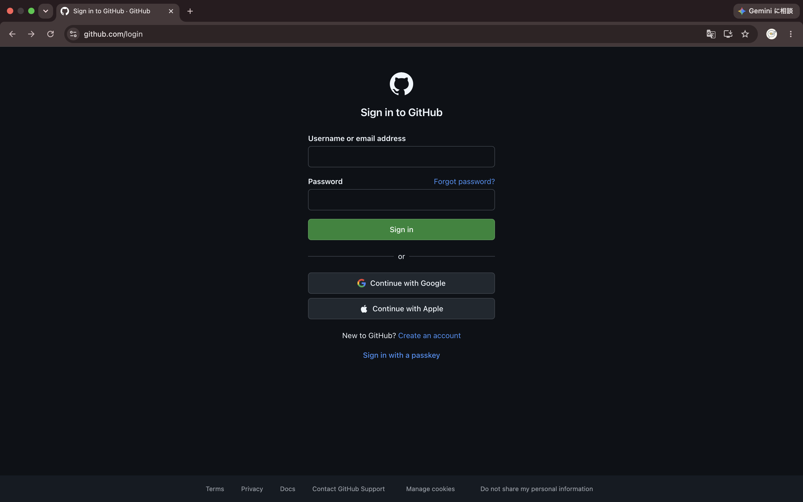
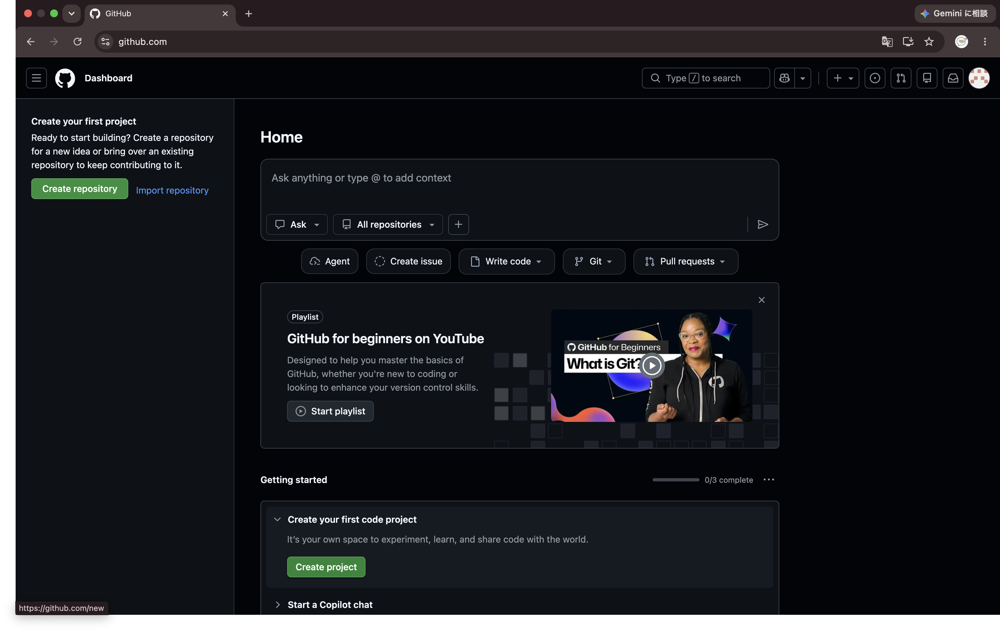
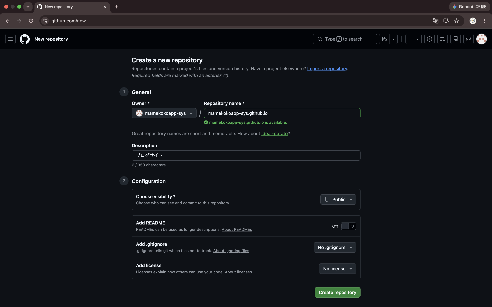

:og:description: AI時代に"自分の温度感"を載せる発信ワークショップ。AIインタビューで思考を引き出し、自分だけの記事を書く体験型セッション。

.. meta::
    :description: AI時代に"自分の温度感"を載せる発信ワークショップ。AIインタビューで思考を引き出し、自分だけの記事を書く体験型セッション。

======================================================================
AI時代に“自分の温度感”を載せるエンジニアブログ入門
======================================================================

副題：AIインタビューで思考を引き出し、自分だけの記事を書く

.. revealjs-slide::
    :conf: {"width":1920,"height":1080}

:author: sion908
:date: 2026/06/20
:event: AI時代の発信ワークショップ

はじめに
======================================================================

.. qrcode::
    :class: center
    :width: 400

    https://slide.sion908.tech/

ここでスライドは公開しています  
ハンズオン中いつでも見返せます。

.. raw:: html

   
(ちなみに自分のポートフォリオもここから飛べます)

アジェンダ
======================================================================

.. container:: flex

    .. container:: size-1

        **タイムテーブル（60分）**

        *   〜10分 AI時代になぜブログを書くのか
        *   〜25分 AIインタビュー体験
        *   〜40分 記事生成
        *   〜50分 温度感の追加
        *   〜60分 公開先の紹介＆Pelicanデモ

    .. container:: size-1

        * AIとの対話で生まれた「自分の考え」
        * 基調講演についての記事下書き
        * 発信を続けるための最初の一歩

.. include:: whois.rst

0. AI時代になぜブログを書くのか（0〜10分）
======================================================================

まず
----------------------------------------------------------------------

基調講演を聞いてどうでしたか？

.. revealjs-fragments::
    * 「            」
    * …で終わっていませんか？
    * それ、もったいないと思います

AIは要約できる。でも…
----------------------------------------------------------------------

.. container:: flex

    .. container:: size-1

        **AIが「書ける」こと**

        * 基調講演の内容を要約する
        * 一般的な解説記事
        * 技術用語の説明

    .. container:: size-1

        **AIが「書けない」こと（＝価値）**

        * **あなたが**\ 何を感じたか
        * **あなたが**\ 何に驚いたか
        * **あなたが**\ どう変わったか

.. revealjs-fragments::
    **「自分はどう思ったか」は本人しか書けない**

    これが今日のテーマ「AI時代に"自分の温度感"を載せる」です。

SNSは流れる、AIは大量生成する
----------------------------------------------------------------------

.. container:: flex

    .. container:: size-2

        **情報の波に埋もれないために**

        * **SNS（X, Facebook）はタイムラインで流れる**

          * 検索しづらい、自分の思考の履歴が残りにくい

        * **AIによる大量のテキスト生成時代**

          * 一般論や簡単な解説記事はAIが一瞬で作れるように
          * だからこそ、\ **「個人の経験」「感情」「一次情報」**\ の価値が相対的に高まっている

        * **ブログは自分の資産**

          * 技術メモ、イベント参加記、地方での活動記録
          * 作ったもののポートフォリオ、自分の思考の成長履歴

1. AIインタビュー体験（10〜25分）
======================================================================

AIを「ライター」ではなく「インタビュアー」にする
----------------------------------------------------------------------

.. container:: flex

    .. container:: size-1

        **多くの人の感想**

        * 「面白かったです」

        **AIにインタビューされると…**

        * 何が面白かった？
        * → AIでゲームが作れるという話
        * なぜそれが面白かった？
        * → プログラミングが難しいと思っていたから
        * じゃあ何が変わった？
        * → 作るハードルが下がったように感じた

    .. container:: size-1

        **この時点で記事の材料になっている**

        * 自分でも気付いていなかった考えが引き出される
        * AIは代筆者ではなく\ **思考の壁打ち相手**

プロンプト例
----------------------------------------------------------------------

.. container:: flex

    .. container:: size-1

        基本版

        .. code-block:: text

            あなたはインタビュアーです。
            私は先ほど基調講演を聞きました。
            その内容についてブログ記事を書きたいです。
            私の感想や考えを引き出したいので、
            質問は1回に1つだけしてください。
            以下を順番に深掘りしてください。
            - 印象に残ったこと
            - 驚いたこと
            - 共感したこと
            - 違和感を持ったこと
            - 自分ならどうするか
            最後に記事構成案を作ってください。

        上級版：自由対話型

        .. code-block:: text

            あなたは優秀なインタビュアーです。
            私は先ほど基調講演を聞きました。
            その内容についてブログ記事を書きたいと思っています。
            私の考えや感想を引き出してください。
            ルール:
            - 一度に質問は1つだけ
            - 私の回答に興味を持ち、自然に深掘りする
            - 想定された質問リストを消化するのではなく、会話として進める
            - 面白そうな話題が出たら優先的に掘り下げる
            - 私自身も気付いていない考えや価値観を引き出す
            - 記事のネタになりそうな部分を見つけたら深掘りする
            - 質問は10回程度を目安にする
            - 十分な材料が集まったら終了し、記事の構成案を提案する
            まず最初の質問をしてください。

さらに面白い方法：「役割」を選ばせる
----------------------------------------------------------------------

.. container:: flex

    .. container:: size-1

        **インタビュアーの視点を変える**

        同じ講演を聞いても…

        * **ジャーナリスト** →「何が新しかったですか？」
        * **起業家** →「それはビジネスになると思いますか？」
        * **エンジニア** →「実装するとしたらどこが難しいですか？」
        * **学生** →「自分の研究にどう活かせますか？」
        * **教師** →「学生に教えるとしたら？」

    .. container:: size-2

        **プロンプト例**

        .. code-block:: text

            次のどれかの立場でインタビューしてください。
            - ジャーナリスト
            - エンジニア仲間
            - ブロガー
            - 起業家
            - 投資家
            - 学生
            - 教師

        かなり違う記事になります。

やってみよう！（ワーク：15分）
----------------------------------------------------------------------

.. container:: flex

    .. container:: size-1

        **使えるAIツール**

        * **Google Gemini** — https://gemini.google.com/
        * **ChatGPT** — https://chat.openai.com/
        * **Claude** — https://claude.ai/

    .. container:: size-1

        **やること**

        1. 好きなプロンプトをコピー
        2. AIに貼り付けて送信
        3. AIの質問に答える（5〜10回）
        4. 材料が集まるのを待つ

2. 記事生成（25〜40分）
======================================================================

AIにまとめさせる
----------------------------------------------------------------------

インタビューが終わったら、次のプロンプトを送ります。

.. code-block:: text

    ここまでの会話を元に
    ブログ記事を書いてください。
    ただし一般論ではなく、
    私自身の感想や考えを中心にしてください。
    文字数は600〜800文字。

3. 温度感の追加（40〜50分）
======================================================================

自分らしさを発見する（おまけプロンプト）
----------------------------------------------------------------------

.. code-block:: text

    ここまでの対話から、
    私らしさが最も出ている発言を3つ抜き出してください。
    なぜそれが私らしいと思ったかも説明してください。

.. revealjs-fragments::
    「記事を書く」よりも、\ **AIとの対話で自分の考えを発見する**\ 体験になります。

4. 公開先の紹介＆Pelicanデモ（50〜60分）
======================================================================

記事を公開する場所
----------------------------------------------------------------------

.. container:: flex

    .. container:: size-1

        **今すぐ公開できるサービス**

        * **Qiita** — https://qiita.com/
          * エンジニア特化型、Markdownで書ける
        * **Zenn** — https://zenn.dev/
          * モダン、本の出版も可能
        * **Note** — https://note.com/
          * 一般層にもリーチしやすい

    .. container:: size-1

        **自分のブログを持ちたいなら**

        * **Pelican × GitHub Pages**
          * Markdownで書いてGit Pushするだけ
          * 無料で自分のドメインも使える
          * エンジニアとしてのポートフォリオにもなる

Pelicanデモ：Markdownからサイトになる
----------------------------------------------------------------------

.. container:: flex

    .. container:: size-1

        **Markdownで記事を書く**

        .. code-block:: markdown

            Title: 基調講演を聞いて考えたこと
            Date: 2026-06-20
            Category: Event
            Tags: AI, ブログ, 発信

            先ほどの基調講演で最も印象に残ったのは…
            （AIインタビューで作った記事をここに）

    .. container:: size-1

        **GitHub Pagesで公開される**

        * Markdownファイルを置いてPushするだけ
        * 自動的にHTMLサイトに変換
        * ``https://USERNAME.github.io/`` で公開

        .. figure:: _imgs/sho/github_dev_port_forwarding.png
            :alt: Codespaces上のPelican
            :width: 100%

Pelican環境構築（資料）
----------------------------------------------------------------------

.. container:: flex

    .. container:: size-1

        **後で試したい人向け**

        * 1. GitHubでリポジトリ作成
        * 2. GitHub.dev/Codespacesで開く
        * 3. ターミナルで以下を実行

        .. code-block:: bash

            python -m venv .venv
            source .venv/bin/activate
            pip install "pelican[markdown]"
            pelican-quickstart

    .. container:: size-1

        **GitHub Actionsで自動公開**

        .. code-block:: yaml

            name: Deploy to GitHub Pages
            on:
              push:
                branches: ["main"]
            jobs:
              deploy:
                uses: "getpelican/pelican/.github/workflows/github_pages.yml@main"
                permissions:
                  contents: "read"
                  pages: "write"
                  id-token: "write"
                with:
                  settings: "publishconf.py"
                  requirements: "-r requirements.txt"

        詳しい手順はスライド資料の付録を参照

    GitHubアカウントがない方はこちらから作成

    リポジトリを作成

    ``github.com`` → ``github.dev`` に書き換えるとブラウザVS Codeが起動

さいごに
======================================================================

今日やったこと
----------------------------------------------------------------------

.. revealjs-fragments::
    * AIにインタビューしてもらった
    * 基調講演の感想を言葉にした
    * AIと対話しながら記事を書いた
    * 自分の考えを発信する方法を知った

今日わかったこと
----------------------------------------------------------------------

.. revealjs-fragments::
    * AIは文章を書くのが得意
    * AIは質問するのも得意
    * 自分では気付かなかった考えが見つかることがある
    * 「自分はどう思ったか」が記事の価値になる

今日のお土産
----------------------------------------------------------------------

.. revealjs-fragments::
    * 基調講演についての記事下書き
    * AIとの対話プロンプト
    * 無料で発信できる方法
    * 次に発信するための最初の一歩

まずは1本出してみよう
----------------------------------------------------------------------

.. revealjs-fragments::
    * 今日書いた記事を少しだけ直す
    * Qiita、Zenn、Note、SNSなど好きな場所に投稿する
    * 完璧を目指さない
    * 発信は1本目が一番難しい

